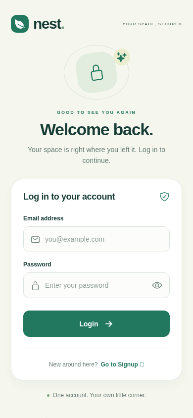
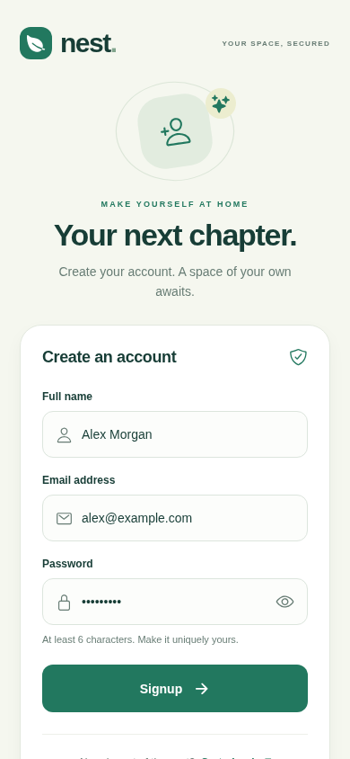
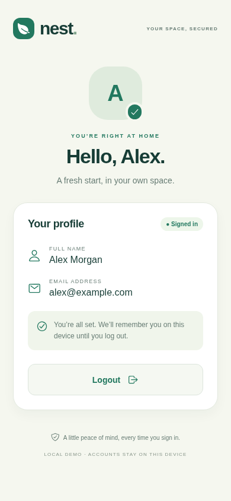

# Nest · Mobile Authentication

React Native + Expo implementation of the **User Authentication App** assignment. Uses React Context for authentication and React Navigation native stacks for Login, Signup, and authenticated Home screens.

## Run

Requires Node.js 22.13+ (Node 24 was used here) and npm.

```sh
npm ci
npm start OR npx expo start
```

Open with an Expo Go version compatible with SDK 58, or use a compatible development build. Press `a` for an installed Android emulator or `i` for an iOS simulator (macOS and Xcode required). A physical phone must be able to reach the Metro server; a remote cloud workspace may require supported port forwarding or running the checkout locally.

For the browser:

```sh
npm run web
```

No backend, API keys, or preconfigured account is needed. Choose **Go to Signup**, enter a name, email and password of at least six characters, and create an account. Signup signs you in automatically.

## Features

- `AuthContext`: `user`, `login`, `signup`, and `logout`.
- Required-field, email, and password validation with inline errors.
- Incorrect-credential errors and case-insensitive duplicate-email rejection.
- Login and Signup navigation; authenticated Home shows the user's name and email.
- Conditional navigation prevents returning to authenticated screens after logout.
- Optional AsyncStorage session persistence, with a loading state during restoration.
- Optional accessible password visibility toggle.
- Responsive sage-and-cream UI, keyboard-aware forms, loading states and disabled submit controls.

## Demo authentication limits

Accounts and sessions live only on this device/browser. Passwords are stored as salted SHA-256 digests rather than plaintext; this is an educational local demo, **not production authentication**. AsyncStorage is not encrypted, fast SHA-256 is not an appropriate production password KDF, and local data can be edited. For production, use a trusted backend or auth provider with server-side password hashing, session validation and platform-secure token storage. Clearing app/browser storage removes the demo accounts.

## Validation

```sh
npm test                 # four form validation checks
npm run build            # Expo web export
npx expo export --platform android --platform ios --output-dir /tmp/mobile-auth-native
npx playwright install chromium
npm run test:e2e
```

The browser test covers signup, profile display, restored sessions, logout persistence, incorrect credentials, duplicate email, successful login and password visibility. It captures phone-width screenshots in `docs/`. It uses system Chromium when available; set `CHROMIUM_PATH` to override or install Playwright Chromium. Android/iOS bundle exports validate bundling, not device runtime behavior; test on a device before release.

## Screenshots

| Login | Signup | Home |
| --- | --- | --- |
|  |  |  |

## Structure

- `App.js`: screens, shared form controls and navigation.
- `src/AuthContext.js`: account creation, authentication and persistence.
- `src/validation.js`: shared form validation.
- `tests/`: unit checks and browser flow.

Project files are prepared in the existing GitHub checkout. No commits or pushes are performed automatically.
